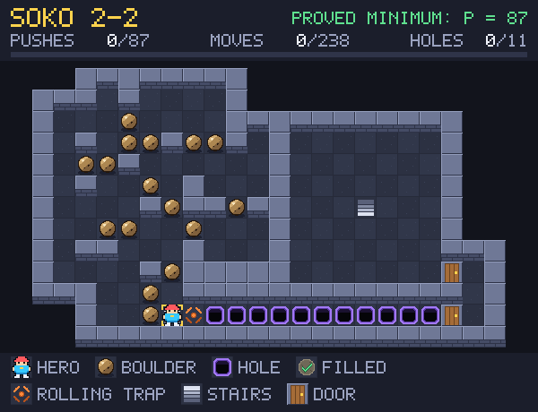
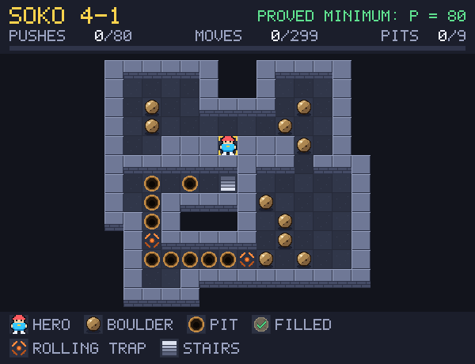
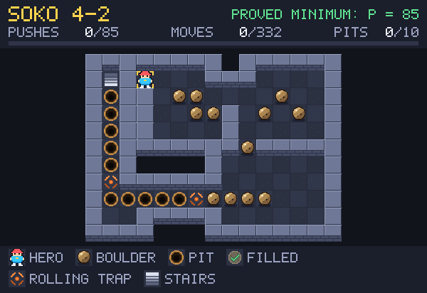
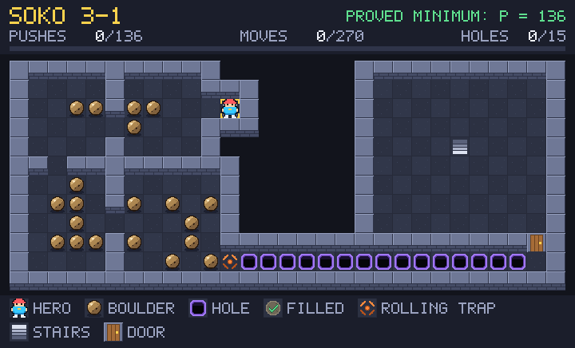
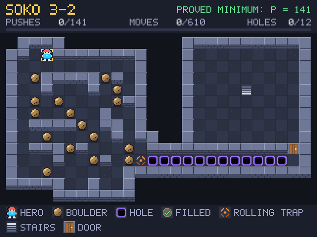
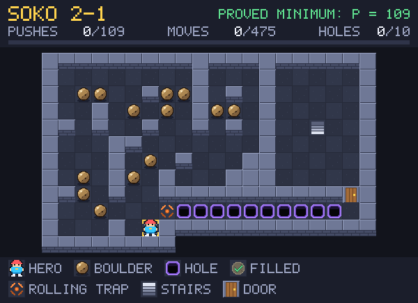
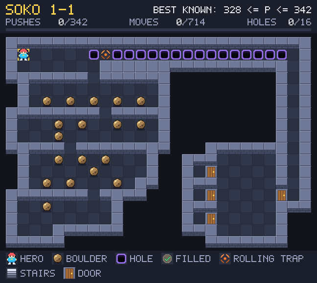
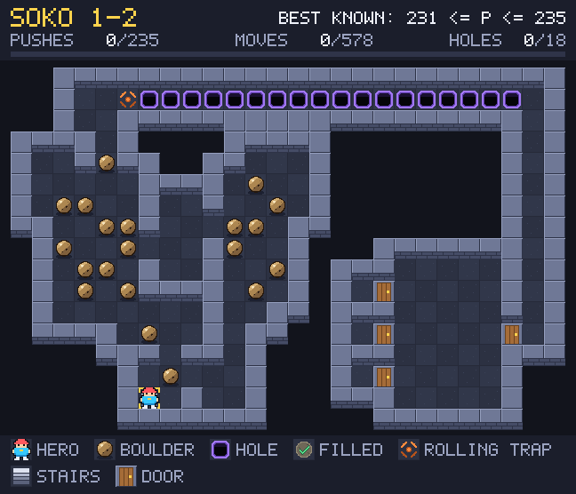

# NetHack Sokoban proofs

Machine-checked answers to one question: **what is the fewest boulder pushes
needed to solve each NetHack Sokoban level?** Proved in Lean 4 for six of the
eight maps of NetHack 5.0, with tight bounds for the other two.



*soko2-2 solved in 87 pushes. No solution with 86 exists.*

## Results

| Map | Minimum pushes | Status | Proof |
| --- | ---: | --- | --- |
| soko4-1 | **80** | exact | [Soko41.lean](lean/Audit/Soko41.lean) |
| soko4-2 | **85** | exact | [Soko42.lean](lean/Audit/Soko42.lean) |
| soko3-1 | **136** | exact | [Soko31.lean](lean/Audit/Soko31.lean) |
| soko3-2 | **141** | exact | [Optimal32_141.lean](research/owner1007/Owner1007/Optimal32_141.lean) |
| soko2-1 | **109** | exact | [Soko21.lean](lean/Audit/Soko21.lean) |
| soko2-2 | **87** | exact | [Soko22.lean](lean/Audit/Soko22.lean) |
| soko1-1 | 328 to 342 | open | [Interval11_328.lean](research/owner1007/Owner1007/Interval11_328.lean) |
| soko1-2 | 231 to 235 | open | [Interval12_231.lean](research/owner1007/Owner1007/Interval12_231.lean) |

Maps are listed in the order you play them: NetHack numbers the floors in
reverse, so `soko4-*` is the entry floor and `soko1-*` is the reward floor.

"Exact" means two theorems: an explicit solution with that many pushes, and a
proof that **every** solution needs at least that many. For the two open maps
the first number is the proved lower bound and the second is the best solution
found.

## All eight solutions

| | |
| :---: | :---: |
| <br>**soko4-1**: 80 pushes, optimal | <br>**soko4-2**: 85 pushes, optimal |
| <br>**soko3-1**: 136 pushes, optimal | <br>**soko3-2**: 141 pushes, optimal |
| <br>**soko2-1**: 109 pushes, optimal | <br>**soko2-2**: 87 pushes, optimal |
| <br>**soko1-1**: 342 pushes, best known | <br>**soko1-2**: 235 pushes, best known |

Each animation replays the exact path that Lean checks. Regenerate them with
`python3 scripts/render_solutions.py` (standard library only).

## How the proofs work

Nothing here enumerates game states; the state spaces are far too large.

- **Solutions** are full lists of single hero steps. Lean executes them in a
  model of the puzzle and confirms that every pit and hole ends up filled.
- **Lower bounds** use a potential function `V` on states with
  `V(before) <= pushes spent + V(after)` for every legal step and `V <= 0`
  at the goal. Summing along any solution gives `V(start) <= total pushes`.
- **The potentials** start from the dual of a boulder-to-hole assignment
  problem and are sharpened with local boulder patterns, the hero's position,
  phases of the solution, and credits that cannot be counted twice.
- **The last three results** (141, 328, 231) are structural arguments about
  boulder identities, parity, and how many boulders must survive. See the
  [research notes](research/owner1007/STATUS.md).
- **Search is untrusted.** External tools propose paths and potentials; only
  what Lean's kernel accepts counts. No `sorry`, `native_decide`, or custom
  axioms.

## Verify it yourself

Requires Python 3.10+, a Unix-like system, and Lean 4.33.1.

```sh
git clone https://github.com/somethingnew179/nethack-sokoban-proofs.git
cd nethack-sokoban-proofs
elan toolchain install leanprover/lean4:v4.33.1

# Fast: manifest, imports, source restrictions, map regeneration. No proofs.
python3 scripts/verify.py check

# One map.
python3 scripts/verify.py build --build-dir ../build-42 --root 4-2

# Everything in the recorded build. About 78 hours and 4 GiB of RAM.
python3 scripts/verify.py build --build-dir ../build

# The three newer results.
python3 research/owner1007/selective_check.py \
  Owner1007.Interval11_328 Owner1007.Interval12_231 Owner1007.Optimal32_141 \
  --cache /tmp/nethack-research-lean4331 --memory-mb 8192
```

The full build is slow because the repository holds about 930 MB of generated
certificate data in 17,853 Lean modules. `scripts/verify.py build` checks the
older bounds recorded in [roots.json](roots.json) (321 to 375, 220 to 235 and
140 to 147 for the three maps that were later improved).

## Layout

| Path | Contents |
| --- | --- |
| `dat/` | The eight original Lua maps from NetHack commit [`b0c09c87`](https://github.com/NetHack/NetHack/tree/b0c09c878e1f9f62bc7ab20e6edafd6108c325a0) |
| `lean/NetHack/Sokoban/` | Puzzle model, maps, solution paths, shared proof machinery |
| `lean/NetHack/Soko*/` | Per-map lower-bound certificates |
| `lean/Audit/` | Final statements for each map |
| `research/owner1007/` | The newer proofs for soko3-2, soko1-1 and soko1-2, with notes |
| `docs/animations/` | The GIFs |
| `scripts/` | Verifier and animation renderer |
| `receipts/` | Records of the completed full build |

## License

The maps come from NetHack and are under the NetHack General Public License,
reproduced in [LICENSE](LICENSE). See [NOTICE.md](NOTICE.md) for attribution
and the status of the proof code.
